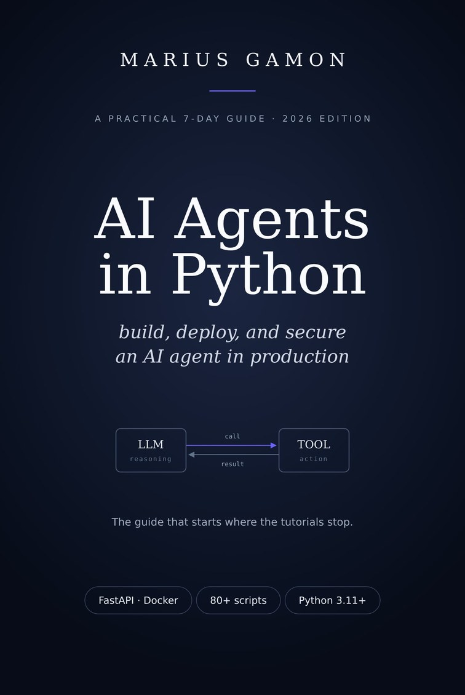

# AI Agents in Python — the book's code

<p align="center">
  
</p>

Companion source code for the book **“AI Agents in Python: Build, Deploy, and Secure an AI Agent in Production”** (Marius Gamon, 2026).

This repository holds the book's code, ready to run. Each file matches the code of the corresponding chapter. The rare differences from the book (fixes found while testing) are listed in [`ERRATA.md`](ERRATA.md).

> The code is the same as the French edition's ([agents-ia-python-book](https://github.com/mariusgamon/agents-ia-python-book)), tested on October 28, 2026 with Python 3.12, `openai-agents==0.24.0`, and `openai==3.40.0`. Comments, prompts, and messages are translated into English.

## Installation

```bash
git clone https://github.com/mariusgamon/ai-agents-python-book.git
cd ai-agents-python-book

python3 -m venv .venv
source .venv/bin/activate          # Windows: .venv\Scripts\activate
pip install -r requirements.txt
# pip install -r requirements-optional.txt   # multi-provider appendices, deepeval, syrupy

cp .env.example .env               # then fill in at least OPENAI_API_KEY
```

Check: `python -c "from agents import Agent; print('OK')"`

## Running a script

As in the book, each folder has its own `config.py` (loads the `.env` and validates the key). **Run the scripts from their folder**:

```bash
cd day1
python first_agent.py
```

The `.env` at the root of the repo is found automatically from any subfolder.

## Contents

| Folder | Chapter |
|---|---|
| `intro_examples/` | Preface — the tech-watch agent, simplified version |
| `day1/` | First agent, reading a file (`data/notes.txt`), cost guardrails, retries |
| `day2/` | Tool calling: VAT, weather, web search, code interpreter, the 4 classic crashes |
| `day3/` | Memory: `SQLiteSession`, `memory_store.py`, semantic memory, costs, targeted lookup |
| `day4/` | Multi-agent: handoffs, LangGraph (sequential, conditional, parallel) |
| `day5/` | Robustness: safe retries, observability (Langfuse, Logfire), tests (`tests/`) |
| `day6/` | Deployment: FastAPI API, Docker, docker-compose, Fly.io, middlewares |
| `day7/` | Case studies: tech watch, sprint report, dev orchestrator, monitoring |
| `bonus_from_scratch/` | Bonus chapter — an agent without a framework (raw Mistral API over HTTP) |
| `appendix/` | Appendices C and E — multi-provider (Claude, OpenRouter, LangGraph), vLLM patch, security |
| `appendix/sandbox/` | Appendix D — Hello Sandbox |
| `templates/` | Templates — Research / Generation / Orchestrator |

## API keys

| Variable | Used by |
|---|---|
| `OPENAI_API_KEY` | almost everything (required) |
| `OPENWEATHER_API_KEY` | `day2/weather_agent.py`, `day5/tools/weather.py` (free key at openweathermap.org) |
| `API_SECRET_KEY` | `day6/` (FastAPI API) |
| `SLACK_WEBHOOK_URL` | `day7/tech_watch.py`, `intro_examples/tech_watch.py` (otherwise the report is printed without being sent) |
| `GITHUB_TOKEN` | `day7/sprint_report.py` |
| `MISTRAL_API_KEY` | `bonus_from_scratch/` |
| `ANTHROPIC_API_KEY`, `OPENROUTER_API_KEY` | `appendix/` (multi-provider) |
| `LANGFUSE_*`, `LOGFIRE_TOKEN` | `day5/observe_with_*.py` |

**Not tested with a real account** (no key available at testing time): `appendix/first_agent_openrouter.py` (OpenRouter) and the actual sending of traces from `day5/observe_with_logfire.py` to Logfire (the script was checked with `LOGFIRE_SEND_TO_LOGFIRE=false`).

By default, the OpenAI Agents SDK sends execution traces to OpenAI. Add `OPENAI_AGENTS_DISABLE_TRACING=1` to the `.env` to turn them off (see §5.5).

## Day 5 — tests

```bash
cd day5
pytest tests/test_tools.py tests/test_pipeline.py tests/test_agent_with_respx.py   # no LLM call, free
pytest tests/                                                                     # everything (calls the API: a few cents)
```

`tools/`, `my_pipeline.py`, and `my_agents.py` are the “production” code that the book's tests import.

## Day 6 — FastAPI API

```bash
cd day6
cp .env.example .env               # OPENAI_API_KEY + API_SECRET_KEY
uvicorn app.main:app --reload --port 8000
# or: docker compose up --build
```

Then `http://localhost:8000/docs`, or:

```bash
curl -X POST http://localhost:8000/api/chat \
  -H "Content-Type: application/json" -H "X-API-Key: <API_SECRET_KEY>" \
  -d '{"message": "Hello"}'
```

`day5/ci/` and `day6/ci/` contain the book's GitHub Actions workflows, to copy into `.github/workflows/` in your own project.

## Files not to run on their own

- **Libraries**, imported by other scripts: `day3/memory_store.py`, `day3/smart_memory_lookup.py`, `day2/tool_*.py`, `day4/email_pipeline_*.py`, `day6/app/…`, `appendix/vllm_compat.py`, etc.
- **Book fragments**, which end with a module-level `await` and use symbols defined in the text: `day2/orchestrator_naive.py`, `day2/orchestrator_relay.py`, `appendix/document_sanitizer.py`. Put them inside your own `async def main()`.
- **Model names**: the code uses the book's (`gpt-5.4-mini`, `gpt-5.4`, `claude-sonnet-4-6`…). Adapt them if your account doesn't have access to them.

## License

The code in this repository is under the MIT license (see [`LICENSE`](LICENSE)). The book's text, figures, and cover are not covered by this license: they remain © Marius Gamon, 2026, all rights reserved.
